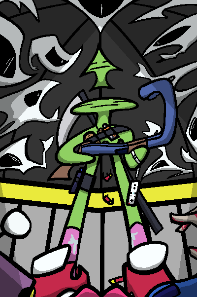
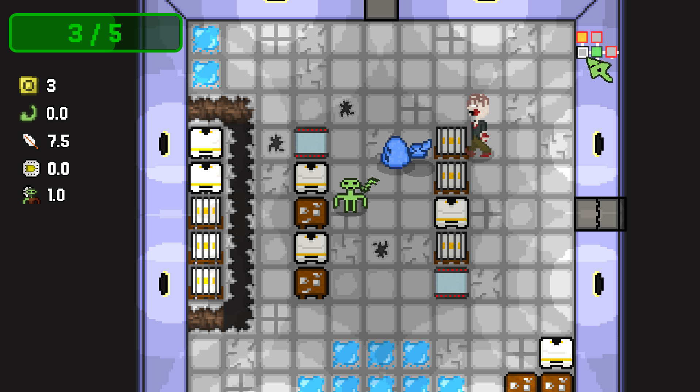
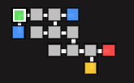
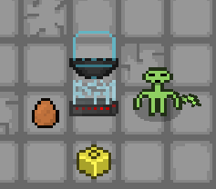
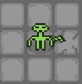
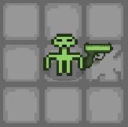
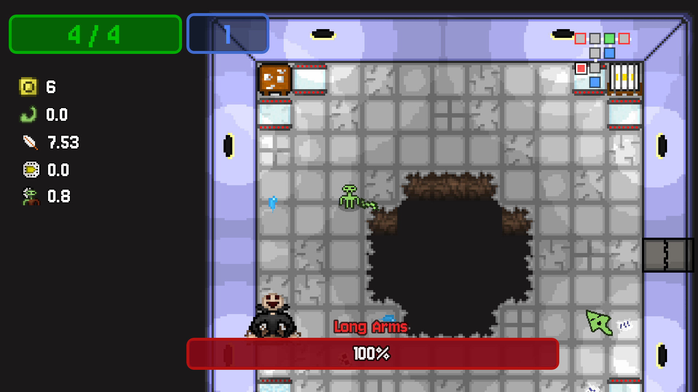

# Alien 51: Escape Mission

A 2D pixel-art roguelike developed in **Godot 4.5** as a Final Degree Project during the 2025-2026 academic year.

Inspired by games such as *The Binding of Isaac* and *Enter the Gungeon*, the project focuses on procedural content generation, modular gameplay systems, AI navigation, and scalable architecture patterns.

The player takes control of an alien attempting to escape from Area 51 while exploring procedurally generated laboratories, defeating enemies, collecting powerful equipment, and creating unique builds through weapons and item combinations.

---

## Download

Download link: https://quicksuperior.itch.io/alien-51-escape-mission

---

## Screenshots

### Gameplay

### Map UI

### Items

### Weapons

### Boss Encounter

---

## Features

### Procedural Dungeon Generation

Each run takes place in a procedurally generated laboratory built using a room-based generation system. The dungeon layout changes every playthrough, creating different routes, encounters and item opportunities.

### Enemy AI

Enemies use Godot's **NavigationAgent2D** to navigate the environment and pursue the player. Different enemy types feature unique movement and attack behaviors, while boss encounters introduce custom combat patterns.

### Weapon System

The game features a modular weapon framework that allows different weapon types, projectile behaviors, and stat interactions.

### Item System

Players can discover and collect a variety of items throughout a run.

- **Passive Items** permanently modify player attributes and gameplay mechanics.
- **Active Items** provide abilities that can be activated during gameplay.

### Inventory System

A dedicated inventory system manages weapons, active items and passive upgrades while keeping player progression organized.

### Stat Modifier System

Character progression is driven by a modifier-based stat system capable of dynamically affecting attributes such as:

- Damage
- Movement Speed
- Health
- Invulnerability Time
- Projectile Lifetime
- Other gameplay-related statistics

### Boss System

Specialized boss encounters feature unique mechanics and act as major progression milestones throughout the game.

### Save System

Game data can be stored and loaded through an integrated save system, allowing player progress and settings to persist between sessions.

### Localization

The project supports both **English** and **Spanish** through a CSV-based localization workflow.

### Audio Management

All music and sound effects are controlled by a centralized audio manager, simplifying volume control and playback across the entire project.

### Object Pooling

Frequently instantiated objects such as projectiles and temporary effects are recycled through object pooling techniques to improve runtime performance and reduce allocation costs.

---

## Technical Highlights

- Procedural map generation
- Room-based dungeon generation
- NavigationAgent2D pathfinding
- Object pooling optimization
- Event Bus architecture
- Signal-driven communication
- Weapon framework
- Active and passive item systems
- Stat modifier system
- Inventory management
- Boss encounters
- Save/load functionality
- CSV-based localization
- Cross-platform deployment

---

## Technology Stack

| Technology | Purpose |
|------------|----------|
| Godot 4.5 | Game Engine |
| GDScript | Gameplay Programming |
| NavigationAgent2D | AI Navigation |
| CSV Files | Localization |
| Signals & Event Bus | System Communication |
| Object Pooling | Performance Optimization |

---

## Architecture

The project follows a modular architecture designed to keep systems loosely coupled and easy to maintain.

Major gameplay features communicate primarily through an Event Bus and Godot signals, reducing direct dependencies between systems and simplifying future modifications.

Implemented subsystems include:

- Audio Manager
- Save Manager
- Localization Manager
- Weapon System
- Item System
- Inventory System
- Enemy AI
- Dungeon Generator
- Boss System

---

## Project Information

**Project Type:** Final Degree Project

**Development Period:** 2025 - 2026

**Developer:** Solo Project

**Platforms:**
- Windows
- Linux
- macOS

**Language:** GDScript

**Engine:** Godot 4.5

---

## About the Project

This project was originally developed as a Final Degree Project with the goal of applying software engineering principles to game development through a complete and fully playable roguelike experience.

After completing the academic requirements, the game was released publicly rather than being left as a university project. While no major updates are currently planned, it remains available as a showcase of the systems, architecture and development techniques implemented during its creation.

